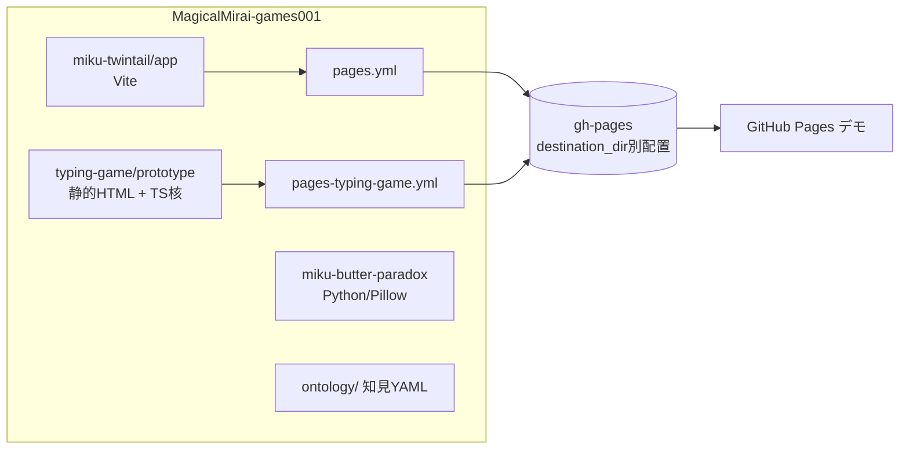

# MagicalMirai-games001

初音ミク「マジカルミライ」プログラミング・コンテストに向けたゲーム企画置き場。
企画ごとにリポジトリ直下のディレクトリに分けて管理する。

- コンテスト: [TextAlive App API](https://developer.textalive.jp/) を使い、課題曲に合わせて動く「リリックアプリ」を応募する(例年 4 月頃募集開始〜7 月締切)
- 公開デモ: GitHub Pages(gh-pages ブランチ配信) https://pyororin.github.io/MagicalMirai-games001/

## 企画一覧

| ディレクトリ | タイトル | 概要 | デモ |
| --- | --- | --- | --- |
| [miku-twintail/](miku-twintail/) | ミクの本体はツインテールである | 日常の物(ホイール・炊飯器など)に歌声由来のツインテールを生やして「ミク度」を競う、福笑い×リズムのゲーム。歌詞の文字が髪になり、コード進行の合いの手が鳴り、サビで自動採点 | [アプリ](https://pyororin.github.io/MagicalMirai-games001/miku-twintail/) ・ [検証モック](https://pyororin.github.io/MagicalMirai-games001/miku-twintail/prototype/) |
| [typing-game/](typing-game/) | 打鍵ミライ(リズムタイピング) | 歌詞を、メロディに乗せて打つ。判定単位を「かな確定」に置きローマ字複数打鍵問題を解消。表記ゆれ全受理・先行入力・難易度別密度制御。スマホは1タッチゾーン式フリック(1かな=1ジェスチャ) | [実楽曲版](https://pyororin.github.io/MagicalMirai-games001/typing-game/prototype/textalive.html) ・ [合成音版](https://pyororin.github.io/MagicalMirai-games001/typing-game/prototype/demo.html) |
| [miku-butter-paradox/](miku-butter-paradox/) | バター猫のパラドックス × ねこみみミク | 背中にバター面上のトーストを固定した猫ミクが着地できずに体軸まわりで回り続けるループ GIF/APNG（Pillow で手続き生成・透過版あり） | [透過GIF](miku-butter-paradox/output/buttercat_miku_alpha.gif) |

> 初音ミク「マジカルミライ」プログラミング・コンテスト向けの**個人の非公式ゲーム企画**集です。クリプトン・フューチャー・メディア、AIST(TextAlive)等の公式プロジェクトではありません。

## 技術スタック(全体)

- フロントエンド: Vanilla JavaScript / TypeScript(判定コア)、Canvas、Web Audio API、Web Speech API
- ビルド/テスト: Vite 5(miku-twintail)、Vitest 2・tsx・kuromoji(typing-game)
- 楽曲・歌詞連携: [TextAlive App API](https://developer.textalive.jp/)(`textalive-app-api` 0.5.2)/ Songle
- 画像生成: Python + Pillow(miku-butter-paradox)
- 配信: GitHub Actions(peaceiris/actions-gh-pages)→ GitHub Pages(gh-pages ブランチ)

## 動作要件

- 遊ぶだけ: 最新のモダンブラウザ(実曲版はネットワーク接続が必要。typing-game 実曲版はスマホ向け)
- 開発: Node.js + npm(miku-twintail / typing-game)、Python 3 + Pillow(miku-butter-paradox)

## 構成



## 各企画の中身

### miku-twintail

| パス | 内容 |
| --- | --- |
| `docs/MARKET_RESEARCH.md` | 市場調査(コンテスト動向・類似作の構造分解・文化的文脈) |
| `docs/DESIGN.md` | 設計書(出落ち回避の 3 層設計、ミク度採点式、枯れた技術の水平思考) |
| `docs/TEXTALIVE_DEV.md` | TextAlive App API 開発ガイド |
| `prototype/index.html` | 依存なし単体 HTML の検証モック(擬似曲・髪物理・採点) |
| `app/` | TextAlive App API 接続版(Vite)。実曲のビート・歌詞・ボーカル音量・サビ検出で動作 |

### typing-game

| パス | 内容 |
| --- | --- |
| `docs/DESIGN.md` | 設計書(かな確定判定・先行入力・密度制御・フリック方式) |
| `docs/MARKET_RESEARCH.md` | 市場調査(過去入賞作、先行作 Typing Lyrics との差分、審査基準) |
| `prototype/src/` | 判定コア(ローマ字トライ・タイミング判定)。ユニットテスト 43 件 |
| `prototype/demo.html` | 合成音+オリジナル歌詞のオフラインデモ(単体 HTML) |
| `prototype/textalive.html` | 実楽曲版。課題曲「ロンリーラン」で実データ検証済み(かな比率 74%、判定窓クランプ必須を確認) |
| `prototype/miku/` | ミクの見た目と仕草のコンポーネント(表情・ポーズ・間奏の仕草)。追加手順は同梱の README |
| `prototype/vendor/` | 同梱ライブラリ(CDN 非依存の同一オリジン配信) |

## 各企画の遊び方・技術・操作

### miku-twintail(ミクの本体はツインテールである)

- **遊び方**: 曲のリズムに合わせて日常のもの(ホイール・炊飯器など)にツインテールを生やす。飛んでくる「□ 髪留め」(最後の1拍前)はタップして最後の拍までなぞり、「〜 髪」(最後の拍)はタップのみ。叩く拍の音が左右にパンするので、耳で左右を判断する。完成した1体は 0〜100 の「ミク度」で採点され、背景に並ぶ。採点式の詳細は [miku-twintail/README.md](miku-twintail/README.md)。
- **操作**: タップ/ドラッグ(なぞる)。一時停止・再開・メニュー復帰、楽曲と拍・効果音の2系統の音量つまみ(値は localStorage に保存)。URL パラメータ `?song=0〜5`(課題曲)、`?diff=easy|normal|hard`、擬似曲版は `?bars=8&bpm=100`。
- **技術**: Vite + `textalive-app-api`、Canvas 描画、Web Audio(拍の音・コードに乗る効果音)、Web Speech(「ミク!」の掛け声)。楽曲アクセスはソングアダプタ(`src/song/`)に閉じ、実曲版(`index.html`)と擬似曲版(`mock.html`)が同じゲーム本体(`src/game/core.js`)を共有。

### typing-game(打鍵ミライ)

- **遊び方**: 歌詞をメロディに乗せて打つリズムタイピング。判定単位は「かな確定」で、ローマ字の複数打鍵(`si`/`shi` 等)は同一視。先行入力と、難易度別の密度制御(間引き)に対応。本編は**スマートフォン専用**で、PC で開くと QR コードでスマホへ誘導する入口ページ。
- **操作**: あ段=タップ、い/う/え/お段=← ↑ → ↓ のフリック、「ん」=↑、「ー」=→、濁点は元の文字と同じ方向、小書き文字は打鍵対象外。画面のどこでも入力でき、指ごとに独立して判定。PC は Space=タップ、矢印キー=フリック。先読み・速度・音量・判定ずれをスライダーで調整可能(localStorage に保存)。
- **技術**: ローマ字トライ/判定コアは TypeScript(`src/romaji.ts`, `src/judge.ts`、Vitest 43 件)、画面は単体 HTML(`textalive.html`/`demo.html`)+ Canvas のドット絵ステージ、`miku/miku.js`(ミクのドット絵コンポーネント)、歌詞の読みは kuromoji で事前生成(`tools/build-readings.mjs` → `data/readings/*.json`)、QR は同梱の qrcode-generator。`data/readings` を fetch するため `file://` では実曲版は動かない(静的サーバー経由で開く)。`demo.html` は TextAlive 非依存の合成音デモ。

### miku-butter-paradox(バター猫のパラドックス × ねこみみミク)

- **内容**: ゲームではなくループアニメの生成物。背中にバター面を上にしたトーストを固定した猫ミクが着地できず回り続ける(480×480・36フレーム・45ms)。
- **使い方/技術**: `pip install -r requirements.txt && python generate.py`(`--with-bg` / `--keyframes` / `--out`)。Pillow のみで手続き生成。成果物は `output/` の透過 GIF/APNG ほか。

## 開発の始め方

```sh
# miku-twintail(Vite アプリ)
cd miku-twintail/app && npm install && npm run dev   # http://localhost:5173

# typing-game(コアのテスト)
cd typing-game/prototype && npm install && npm test  # vitest 43件
# demo.html / textalive.html はビルド不要。ブラウザで直接開ける
```

ホスト接続テスト(応募時の挙動)は [TextAlive App Debugger](https://developer.textalive.jp/app/) に localhost の URL を入力する。

## ⚠ 開発前に読むこと — ontology/

**躓いた点の知見は [ontology/](ontology/) に集約している**(症状から引ける YAML)。
「読み込み中で止まる」「Pages が 404」「sandbox から API に届かない」「効果音が遅れて聞こえる」
などは既知の解決策がある。新しいセッション・別アプリの開発時は、デバッグの前にまずここを読むこと。
解決した躓きは追記すること。

- [ontology/textalive.yaml](ontology/textalive.yaml) — TextAlive / Songle(必要ドメイン、Card data resolver エラーの2系統の原因とフォールバック、読みデータ非提供、曲の長さと歌詞の終わりの違い、口パクの同期元ほか)
- [ontology/infra.yaml](ontology/infra.yaml) — GitHub Pages / Actions / sandbox / ブラウザ実装(gh-pages の消し合い、キャッシュとビルド番号、タグ push が通らない、ヘッドレス検証の型、[hidden] が効かない、var の巻き上げで演出が消える ほか)
- [ontology/rhythm-game.yaml](ontology/rhythm-game.yaml) — リズムゲームの判定・入力・体感(判定窓が失敗音の遅れを決める、打ち逃しが次の入力を吸う、効果音の重ねすぎ、放射レイアウトのトレードオフ ほか)

## デプロイ

企画ごとのワークフロー(`.github/workflows/pages.yml` = miku-twintail、`pages-typing-game.yml` = typing-game + ランディング)が gh-pages にデプロイする。
**必ず `destination_dir: <企画ディレクトリ>` を使い、他企画のディレクトリを保持すること**
(全置換方式は他企画を消す。詳細は ontology/infra.yaml の gh-pages-mutual-wipe)。
Pages の反映は CDN キャッシュで最大10分程度。typing-game のページはビルド番号表示で版を確認できる。

## 注意事項・権利表記

- 本リポジトリは非営利の個人制作です。初音ミクはクリプトン・フューチャー・メディア株式会社のキャラクターで、[ピアプロ・キャラクター・ライセンス](https://piapro.jp/license/pcl/summary) に基づく非営利の二次創作として扱ってください(miku-butter-paradox の記載に準拠)。miku-twintail の「ミク!」の掛け声はブラウザ音声合成で、ミクの音声素材は使用していません。
- 楽曲・歌詞の著作権は各権利者に帰属します。TextAlive App API / Songle の利用規約への同意が必要で、商用利用は事前に AIST TextAlive への相談が必要です(`typing-game/prototype/vendor/TEXTALIVE-LICENSE.md` 参照)。
- TextAlive のアプリトークンはクライアント埋め込み前提の公開値という扱いです。アプリ URL の登録は公開先と揃えてください。
- 実曲版は外部サービス(TextAlive/Songle/piapro)に依存するため、サービス側の変更や障害で動作しなくなることがあります。
